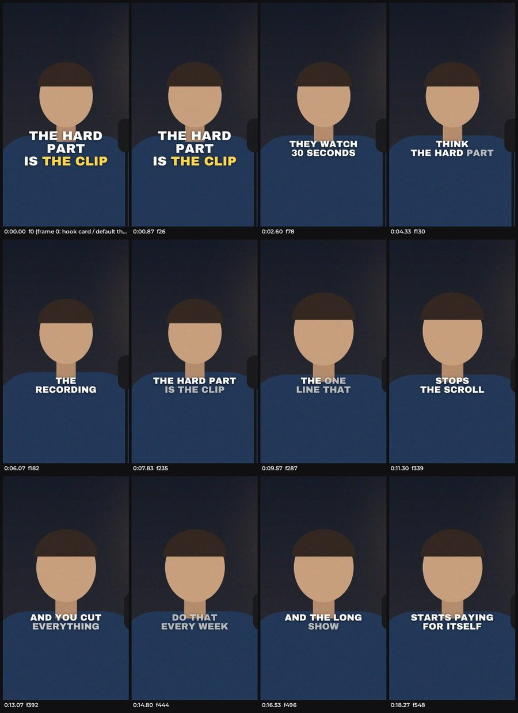

# hook-cutter

A Claude Code skill that turns long-form video (a podcast, interview, talk, panel or webinar)
into captioned vertical Shorts and Reels, plus optional 16:9 clips. It finds the hooks, makes the
cuts and adds the captions, then checks its own work with a QA pass. The AI agent supplies the
editorial judgment; local scripts do the mechanics deterministically and write inspectable JSON
at every step. It ends at local files: nothing is posted or published ([Privacy](#privacy) says
what the agent reads).



*Twelve frames of the Short `hc demo` makes from a made-up 20-second recording: a hook card on
frame 0, then word-by-word captions through a cold open, the setup and the close.*

This is early software (version 0.2), run so far on one Apple Silicon Mac. Read
[Known issues](#known-issues) before you post anything it makes.

## Try it in a minute

After the three install steps below, run:

```
python3 ~/.claude/skills/hook-cutter/scripts/hc demo --open
```

It writes a 20-second recording (a drawn speaker and your computer's text-to-speech voice), then
runs the same commands a real session runs: transcribe, cut it hook-first, caption it, make a
cover, check it with QA and export it. It took under a minute on the Mac it was built on; the
first run also downloads a small speech model (75 MB). It ends by opening the finished Short and listing what to look at: the
cover, the QA summary, the by-ear checklist and the edit spec it wrote. The made-up recording
raises a few QA warnings a real one would not (there is no real face to find). The demo lives in
`~/hook-cutter-demo`; delete the folder when you are done with it.

## What makes it different

- **Compositional cuts, not window extraction.** A clip can open on the strongest line even when
  it lives mid-passage, rewind to the setup, drop a point that repeats and end clean. A boundary
  is a word index (or a source time), snapped to quiet audio on the frame grid.
- **Judgment written down.** A moments ledger with hard gates and named reasons
  (`references/hooks.md`) instead of a virality score nobody can verify.
- **Captions built to stay legible.** Measured backing only when the background is bright, one
  accent word taken from the hook card, and a hook card fully visible on frame 0 so the default
  thumbnail is never empty.
- **Audio and picture sync you can test.** A regression test cuts 30 pieces around
  flash-and-click pairs and fails if any click lands more than one frame from its flash. QA also
  re-transcribes every render to check that no word was lost. Caption timing is checked less
  well: see [Known issues](#known-issues).
- **Fidelity first.** Misattribution, guessed words and invented numbers are treated as the
  worst possible failures, with gates to match.

## Example output

A session ends with a project folder like this (the names are made up):

```
episode-14/
  moments.md                               every candidate moment with a status and a reason
  clips.json                               the edit spec the user approved
  renders/c01-fired-biggest-client__vertical__clean.mp4   1080x1920 H.264/AAC, 15-90 s, -14 LUFS
  renders/c01-fired-biggest-client__vertical__clean.srt   sidecar captions (a draft, not exported)
  covers/c01-fired-biggest-client__clean.jpg   1080x1920 cover, plus .grid.jpg and .mobile.jpg
  sheets/                                  contact sheets, seam strips, cover candidates, covers grid
  qa/summary.md                            every gate PASS, WARN, FAIL or SKIPPED, with evidence
  export/Clean/01 - Why I fired my biggest client.mp4
  export/Clean/01 - Why I fired my biggest client - Cover.jpg
  export/manifest.json                     titles, speakers, hook cards, covers, post copy, QA status
  export/by-ear.md                         every join, opening and ending to listen to, with times
```

Each clip opens on its hook with a two or three line hook card over live picture. Captions fill
word by word in a heavy sans with one accent word on the claim, the speaker stays framed through
shot changes, and audio is loudness-normalised for the platforms.

## Install

These steps are for an Apple Silicon Mac, the only kind of machine it has been run on (see
[Requirements](#requirements)).

**1. Tools.** You need [Homebrew](https://brew.sh). Its installer also sets up Apple's Command
Line Tools (on a new Mac, `git` and `python3` do not work until those are installed) and ends
with "Next steps" that put `brew` on your PATH: do them. Then, in a terminal:

```
brew install ffmpeg uv           # uv provides Python 3.12
```

**2. Clone** the repository into your Claude Code skills folder as
`~/.claude/skills/hook-cutter`. The clone command is the last line of this page, under "Built
by": copy it into the terminal.

**3. Set up.**

```
python3 ~/.claude/skills/hook-cutter/scripts/hc doctor --install
```

Checked on 2026-10-10 on one Apple Silicon Mac (macOS 26.5) that already had Homebrew, uv
0.11.8 and ffmpeg 8.1: from an empty data folder, the line above reached `READY` in under 30
seconds, and the skill's own tests passed, including the two that download and run the speech
model. Not checked: installing Homebrew, ffmpeg or uv from nothing (Homebrew now ships ffmpeg 9
and a newer uv) and any other machine or macOS version.

`doctor` prints a table of checks that ends in `READY` or `NOT READY`, and says exactly what is
missing; after `READY` it suggests the demo. `WARN` and `SKIPPED` rows do not block `READY`. Expect a `WARN` on `asr model` (the
speech model has not been downloaded yet) and, with Homebrew's ffmpeg, one on `filter zscale`
(it matters only for HDR sources). uv prints an `Activate with:` line: ignore it, nothing needs
activating. To update later, run `git pull` in the skill folder and then the `doctor --install`
line again.

To run the tests yourself: `python3 ~/.claude/skills/hook-cutter/scripts/hc test` (about three
and a half minutes on that Mac; add `--slow` for the tests that run a speech model and the demo). Lines such as
`FAIL G8` and `qa: exit 1` in the output come from tests that plant a defect on purpose; only
the last line is the verdict.

Optional extras, added to the `doctor --install` line (combine them with a comma:
`--with mlx,url`):

| Flag | Adds |
|---|---|
| `--with url` | yt-dlp, for YouTube and other URLs (YouTube also needs `deno` or `node` on PATH); run it again to update yt-dlp |
| `--with mlx` | mlx-whisper, faster transcription on Apple Silicon (about 1 GB more packages, and its own copy of the speech model) |
| `--with whispercpp` | nothing is installed: `doctor` checks for a `whisper-cli` (whisper.cpp) you already have. That backend also needs a model file, named in `HOOKCUTTER_WHISPERCPP_MODEL`. It was not part of the install check |
| `--model large-v3-turbo` | download the speech model now (about 1.6 GB) instead of on first use; add `--backend faster-whisper` or `--backend mlx` to choose which backend's copy |
| `--python PATH` | build the venv from this interpreter (3.12 or 3.13); a different version than the existing venv rebuilds it |

The first transcription downloads the speech model (about 1.6 GB) without showing progress, so
it can look stalled for several minutes. It may also print a warning that asks for an
`HF_TOKEN`: none is needed. Each backend keeps its own copy, so the first transcription after
`--with mlx` downloads a second one, even though `doctor` already shows `asr model PASS`.

Installs use prebuilt wheels only (nothing is compiled from source), so an OS older than the
floors below fails fast with a clear message instead of a long build. The packages the skill
imports are pinned to exact versions (`scripts/requirements*.txt`); their own dependencies are
not locked and nothing is hash-checked, and yt-dlp is installed at its newest version. Three of
those unlocked dependencies changed version in the two days before the install check, and the
tests still passed. Homebrew installs whatever ffmpeg and uv are current that day.

Runtime files (the venv, models, caches including Python bytecode, your own presets and fonts)
live in your user data folder, never in the skill folder: `~/Library/Application
Support/hook-cutter` on macOS, `~/.local/share/hook-cutter` on Linux, `%LOCALAPPDATA%\hook-cutter`
on Windows. Set `HOOKCUTTER_HOME` to put them somewhere else.

## Quick start

Open a new Claude Code session. Claude Code finds the skill in that folder by itself (you can
also type `/hook-cutter`), and by default it asks before it runs each of the skill's commands.
Say something like:

> Cut vertical Shorts from ~/Videos/episode-14.mp4. Use ~/Clips/episode-14 as the project
> folder. It's my own show and I'm the host. Find the hooks and show me a shortlist before you
> cut anything.

What happens next:

1. **It starts with questions.** One message covering the source, the project folder, who the
   clips are for, rights and branding, and anything already posted from this recording. Rights
   come first: do you have the rights to this footage, and whose brand does it carry? It never
   applies another organisation's branding. The example above already answers most of this.
2. **It reads the recording.** It ingests and transcribes the video, then mines the transcript
   into a moments ledger. The first transcription downloads the speech model, silently, unless
   you fetched it during install.
3. **Your first decision: the shortlist.** It shows a table with one row per candidate (the
   speaker, the hook line word for word, where it sits in the recording, an estimated length and
   why it was picked; about eight per hour of source at most) and stops. You approve, cut or
   add. Nothing is cut before this.
4. **It builds the clips.** It checks who is on camera, writes the edit spec, renders, reads its
   own contact sheets, makes covers and runs QA. A clip whose hook line it cannot attribute with
   certainty is dropped, and it tells you.
5. **Your second decision: the files.** It hands you the `export/` folder, a grid of the covers,
   the QA summary and, for each clip, the hook card, cover headline and title. A clip whose QA
   failed or is incomplete is held back and listed. `export/by-ear.md` lists every join, the
   opening and the ending of each clip with the words on both sides and the time in the file:
   play each clip with it open before you accept it (see [Known issues](#known-issues)).

Give notes in plain words ("open stronger", "the laugh got cut") and it re-renders only what
changed.

Everything for a recording lives in the project folder you named, so pick a lasting one, not a
temporary folder. The finished files are in its `export/` subfolder. Posting them is up to you:
the skill never uploads or publishes. No run time is promised: the one production run took
about two and a half hours for eleven clips with several agents working at once, and a single
session like the one above has not been timed.

## Known issues

Version 0.2. One production run has finished, on version 0.1: 26 Shorts from one hour-long
recording, on one Apple Silicon Mac, with an editing agent and a separate reviewing agent per
clip (more checking than the single session in Quick start gets). The agents that cut eleven of
those clips alone reported 41 code defects, 16 documentation gaps and 10 limits. Version 0.2
fixed the ones a new user meets first (`CHANGELOG.md`); the rest stand, and the most common are
below.

**The agent cannot listen.** It judges sound by re-transcribing it and by measuring levels.
Every export writes `export/by-ear.md`, the list of places to listen to; play every clip with it
open before you post anything. Most of this list is the reason why.

- **Word times can still be wrong.** The transcript's word times are moved onto the audio, and
  0.2 fixed the two errors seen most: a word whose end the recogniser ran on into a pause was
  dragged past the pause, and the word after a pause started late, so a cut there clipped its
  first sound. On the recordings the tests measure, a start after a pause now lands within a few
  hundredths of a second of the voice. Other errors remain (two words run together with no
  pause between them have no edge to measure). Listen for a clipped word, or a caption that
  lights early or late, and tell the agent where it is.
- **Some false starts are not flagged.** A visible restart ("I was, I was going", "the the")
  is flagged `false_start` since 0.2, as is one the recogniser folds into a single long word. A
  stumble it writes as one clean phrase, or a word it misses entirely, still gets no warning.
- **A cut edge can land inside a neighbouring word with no warning.** The planner moves each
  edge to the quietest frame nearby, and that frame can be inside the word before or after. You
  hear a stray syllable or a clipped word at the join. Report the join: the fix is an offset of
  a few frames on that edge.
- **The caption-sync gate can pass a caption that lights early.** QA gate G10 has passed
  captions that lit up to 0.44 s before their word. Watch every clip with the sound on and
  report the word and the time. No setting moves one word's caption time.
- **The `.srt` sidecar is a draft.** Since 0.2 it no longer leaves one word alone in a cue or
  breaks inside a number phrase ("12 to | 18 months"), but a cue still ends at every cut, even
  mid-sentence (a subtitle never runs across a cut in the picture). Read it before you upload
  it. It sits in `renders/` and is not copied to `export/`; the burned-in captions are paged
  separately.
- **Some QA warnings can never clear.** The word check (G5) compares what it hears in the
  render with the transcript's words, not with what the clip shows, so a WARN can stay on a
  clip that is right. The agent should explain in one line every WARN it leaves.
- **The caption background can flip for a whole clip after an unrelated edit.** In `auto` mode
  the choice can sit right at its threshold, and neither the plan nor QA reports the change of
  look. If a re-render looks different, ask for the backing to be always on or always off for
  that clip.

## Requirements

**It has been run on one machine: an Apple Silicon Mac on macOS 26.5, with ffmpeg 8.1 and uv
0.11.8 from Homebrew, and Python 3.12.** Intel Macs, Linux and Windows are designed for but
untested. The floors below are what the pinned packages need on paper, not a promise that it
works there.

- **Claude Code**, and `git` or the GitHub CLI to clone the repository.
- **OS:** macOS 13 or newer on Apple Silicon, of which only macOS 26 has been run. On macOS 13
  the install picks older versions of some unpinned dependencies (av and onnxruntime, plus mlx
  and torch for the mlx extra), a set that has never been run. Untested: macOS 14 or newer on
  Intel, Linux (x86_64 or arm64), and Windows (best effort; WSL is recommended). The macOS
  floors are there because the pinned OpenCV publishes wheels only for those versions.
- **ffmpeg and ffprobe 6.0 or newer** with libx264 and AAC; only 8.1 has been run. libass,
  drawtext and fontconfig are not needed: all text is drawn from bundled fonts. macOS:
  `brew install ffmpeg`; on 2026-10-10 Homebrew's ffmpeg was at 9.0, a version not yet tried
  with this skill. Linux (untested): `apt install ffmpeg` is new enough only on Ubuntu 24.04+
  and Debian 13+ (Ubuntu 22.04 ships 4.4 and Debian 12 ships 5.1); elsewhere use a static build
  from https://ffmpeg.org/download.html. On any system you can point `HOOKCUTTER_FFMPEG` and
  `HOOKCUTTER_FFPROBE` at other binaries, for example an 8.x build if 9 misbehaves. HDR sources
  need a build with `zscale`; `doctor` checks for it.
- **Python:** any `python3` 3.9 or newer starts the installer (the one in Apple's Command Line
  Tools is fine). The venv runs Python 3.12 or 3.13 (the pinned NumPy needs 3.12); only 3.12 has
  been run. uv is the default path: with `uv` installed, `doctor --install` builds a 3.12 venv
  with it (uv fetches Python itself, which is the only easy route on Ubuntu 22.04 and Debian
  12). Without Homebrew, uv's own installer is
  `curl -LsSf https://astral.sh/uv/install.sh | sh`, then a new terminal window. Without uv,
  `doctor --install` uses a `python3.12` or `python3.13` from PATH; `--python PATH` picks the
  interpreter (use it for 3.13).
- **Disk:** about 330 MB for the packages (1.3 GB with the mlx extra) and 1.6 GB for each
  speech model, plus working space in the project folder for lossless intermediate segments (a
  few GB for an hour of 1080p). `doctor` warns when less than 5 GB is free.
- **For the demo only:** a text-to-speech voice, `say` (built into macOS) or espeak-ng on Linux
  (`apt install espeak-ng`).
- **Language:** English-first. Other languages transcribe and caption; filler removal and some
  editing lints are tuned for English.

## Privacy

Speech recognition, face detection, framing and rendering all run on your machine. The
transcript, the moments ledger and every image the agent opens (contact sheets, covers, frames
of your video) are read by the AI agent running the skill, so they reach your model provider
under your agreement with them. The speech model is downloaded from Hugging Face on first use;
the face model ships with the skill. URL sources are downloaded with yt-dlp. The scripts
contain no upload or posting code, and the skill's instructions forbid the agent to upload,
post or schedule anything.

## Credits

Whisper (OpenAI), faster-whisper (SYSTRAN) and CTranslate2 (OpenNMT), mlx-whisper (Apple
ml-explore), the YuNet face detector (Shiqi Yu, via the OpenCV Zoo), OpenCV, Pillow, NumPy,
fontTools, yt-dlp and FFmpeg. Fonts: Archivo Black, Anton and Montserrat, under the SIL Open Font
License. The editing doctrine draws on public research cited in the references, including
Zannettou et al. (CHI 2024) on short-video attention, Dost and Huang on cut pacing in
talking-head video, and broadcast subtitle guidelines. Licences: `THIRD_PARTY.md`.

## License

MIT, see `LICENSE`. Bundled fonts and the face model keep their own licences (`THIRD_PARTY.md`).

## Built by Mike Bledsoe

Mike helps creators turn the attention they have earned into a real business, working as their
fractional operator: [bledsoe.life](https://bledsoe.life)

Clone command for step 2 of Install:

    git clone https://github.com/mike-bledsoe/hook-cutter.git ~/.claude/skills/hook-cutter
